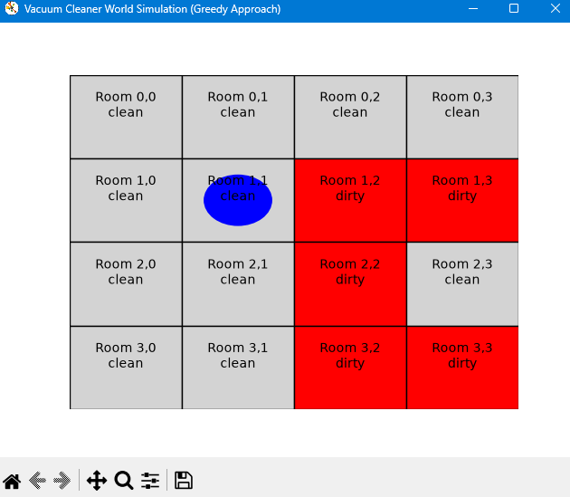
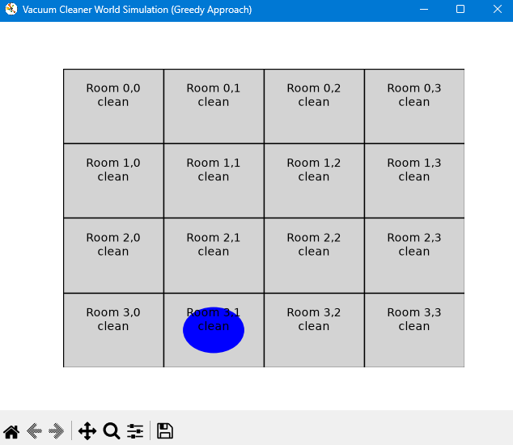

# Vacuum Cleaner World Simulation

A visual simulation of an **intelligent vacuum cleaner agent** operating in a grid of rooms. The agent uses a **greedy nearest-neighbor strategy** to find and clean every dirty room as efficiently as possible - all animated in real time with Matplotlib.

This is a classic example from **artificial intelligence** textbooks (Russell & Norvig's *AIMA*), demonstrating how a simple rational agent can solve a well-defined environment.

 

## How It Works

- The environment is a 2D grid of rooms, each randomly initialized as **clean** (grey) or **dirty** (red).
- The vacuum agent starts in the **top-left corner** and is shown as a blue circle.
- Each step, the agent:
  1. **Cleans** its current room if it's dirty.
  2. **Moves** one step toward the nearest dirty room (using Manhattan distance).
- The simulation ends when **all rooms are clean**.
- Every action is logged to the console at the end.

## Requirements

- **Python 3.12**
- `matplotlib`

## Installation
```bash
# Clone the repo
git clone https://github.com/einye/vacuum_cleaner.git
cd vacuum_cleaner

# (Recommended) Create a virtual environment
python3.12 -m venv venv         # Python 3.12 recommended
source venv/bin/activate        # Windows: venv\Scripts\activate

# Install dependencies
pip install matplotlib
```

## Acknowledgements

Artificial Intelligence: A Modern Approach (Russell & Norvig) - for the classic vacuum world problem